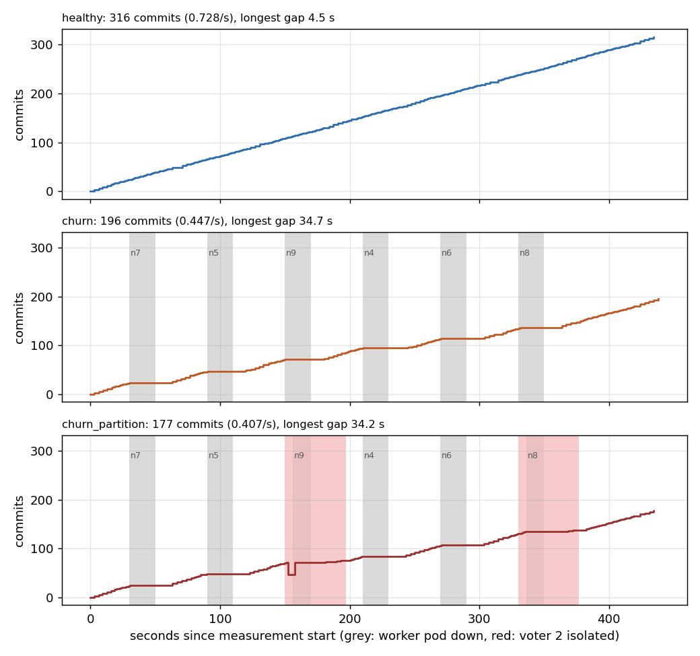
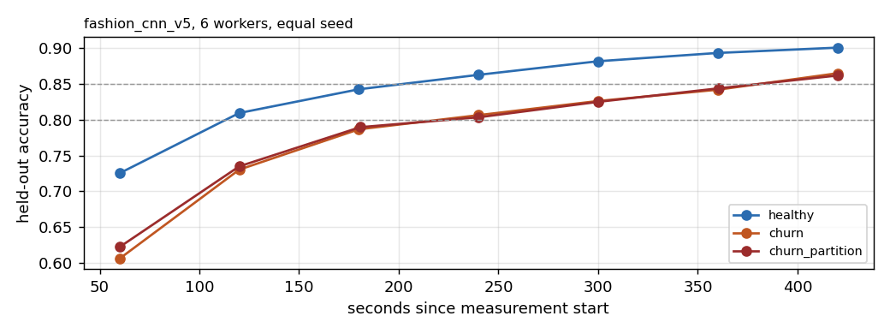

# Jepsen-style analysis: ElasticML MS3

*Team-05 Red Team · 2026-11-17*

ElasticML is a distributed training system that replicates a neural network's optimizer state on three voters through a hand-written multi-slot Paxos log, while elastic worker fleets push gradients through a tree of reducers. We tested ElasticML's MS3 specification against the running code, in process and on a local HOKEA Docker cluster with crashes, restarts, partitions, disk rollback and worker churn. Under the fault model the specification states, we found that a single voter's disk rollback lets one log slot choose two values. We also found that a retried gradient can be applied twice, that an acknowledged update can be lost in the default deployment mode, and that one worker crash, or one malformed request, can halt training indefinitely. The specification makes no performance guarantees, so we stated the bounds a reasonable user would assume and measured against them. Under the fault the system exists to handle, workers leaving and rejoining, every departure stopped all training for about 30 seconds. The selected accuracy profile fell to 61% of its healthy commit rate, and took twice as long to reach each accuracy target. One slow worker cut the whole cluster to 41%. Paxos itself held up: 12 randomized in-process schedules, plus 1,081 updates on HOKEA under random partitions and 25% packet loss, produced no divergent slot and no duplicate application. This analysis was performed by a student red team. No ElasticML code was modified.

---

## 1 Background

ElasticML trains one model, `fashion_cnn_v5` (462,570 parameters, Fashion-MNIST), across an arbitrary number of CPU workers. Each optimizer step is one entry in a replicated log. Three **voters** each hold a durable acceptor per log slot, a learner, and a copy of the model and optimizer state. When a value is chosen for slot *n*, every voter applies it to version *n − 1* and gets version *n*. Only voters have authority. The specification says plainly that everything else adds capacity, not authority.

Workers never talk to Paxos directly in the configurations that produced the published results. Fewer than five workers submit to the voters, which **aggregate a cohort** and commit it with a partial flush if some members are late. Five or more workers submit to a **reducer tree**: each leaf reducer averages one *cell* of up to eight workers' int8-quantized gradients, a root reducer averages the leaves, and the root proposes one float16 aggregate per optimizer step to a preferred voter. The specification says each primary reducer has a deterministic backup that shares its identity, so a worker can retry against the backup without creating a second contribution.

With three voters and majority quorums, ElasticML tolerates the loss of one voter. Losing two stops commits until one returns with its durable state intact, and the specification promises that a minority voter fails closed rather than serving stale reads or accepting writes. The project does not use etcd, ZooKeeper, or a consensus library. The Paxos implementation, its durable slot files, and the recovery and learning paths are about 600 lines of project code.

There is also a second deployment mode. The configuration default, `election_backend = "single"`, is a single coordinator process that writes to three local mirror directories with configurable read and write quorums. It is not replicated across machines. The specification's guarantees are written for the three-voter mode. Section 2 discusses which guarantees apply to which mode.

The published result is one physical-cluster run: 20 one-core workers, three voters, three leaf reducers and one root reducer. It reached 94.68% validation accuracy, crossed 94% at 945 seconds, and committed 1,355.89 examples per second.

## 2 Test Design

The MS3 specification has many guarantees for safety, liveness, and the fault model. Section 4 lists eight safety properties and four liveness properties, and says that each is a guarantee with automated tests:

| | Property | Claim, paraphrased |
|---|---|---|
| S1 | At-most-once | A worker contribution is applied at most once, even across retries and ambiguous outcomes. |
| S2 | Single value | Each log slot chooses at most one value. |
| S3 | Durable acknowledgement | An update acknowledged `applied` survives crashes. |
| S4 | Version bounds | Committed updates respect version and staleness bounds. |
| S5 | Input validity | Non-finite, malformed, or oversized input is rejected and does not change the model. |
| S6 | Read freshness | A model read includes every update whose acknowledgement completed before the read began. |
| S7 | Deterministic application | Every voter applies the same aggregate members in the same order. |
| S8 | Fail closed | A voter without a quorum neither commits nor serves authoritative reads. |
| L1 | Worker loss | Training continues after workers crash. |
| L2 | Join and rejoin | Workers can join and rejoin. |
| L3 | Voter failover | Training continues after one voter fails. |
| L4 | Reducer failover | Training continues after a reducer fails, via its backup. |

Liveness is conditional on "eventually limited proposer contention" and at least one healthy, retrying worker.

Section 5 in the team's project report is the fault model. It *includes* worker crash, restart, churn and heterogeneous speed; one voter crashing or restarting with its durable files; reducer crash with failover to the backup; dropped, delayed, duplicated and retried requests; temporary partitions; crashes between acceptance, application and acknowledgement; and total quorum loss. It *excludes* Byzantine processes, corrupt or rolled-back durable state **for a majority**, two processes sharing one replica identity, and a voter that restarts without its durable files. The specification notes that a HOKEA container restart wipes local storage, so a restarted HOKEA voter falls in the excluded category.

The specification does not say which guarantees cover which deployment profile. Reading the code, we think the guarantees should look like this:

| Profile | S1 | S2 | S3 | S5 | S7 | L1 | L4 |
|---|---|---|---|---|---|---|---|
| Single coordinator, mirrored storage (the configuration default) | ✓ | n/a | depends on W + R > N | ✓ | n/a | ✓ | n/a |
| Three voters, voter-side cohorts (≤ 4 workers, the HOKEA default) | ✓ | ✓ | ✓ | ✓ | ✓ | ✓ | n/a |
| Three voters, reducer tree, staleness 0 (selected profile) | ✓ | ✓ | ✓ | ✓ | ✓ | ✓ | ✓ |
| Three voters, reducer tree, `allow_stale` | ✓ | ✓ | ✓ | ✓ | ✓ | ✓ | ✓ |

A ✓ means the specification claims the property, as far as we can tell. That leaves several open questions. What does "training continues" mean when the reducer that a quarter of the workers depend on has no backup? And since §7 promises equal-seed comparisons across fault scenarios but publishes none, what happens to performance when workers actually leave?

Let's write some tests to find out.

### 2.1 Setup

We ran three kinds of tests.

**In process.** The real FastAPI voter app, `ConsensusRuntime`, `GradientReducer`, `MirroredStore` and codecs, wired together with Starlette's `TestClient` and a fake peer transport that can drop requests, lose replies, or restart a voter from its durable files. These tests are deterministic and take about five seconds in total.

**Fuzzed Paxos.** A `FlakyCluster` transport drops 15% of requests, loses 15% of replies after the remote side has acted, and restarts a voter from disk on 5% of calls, while two proposers compete for the same slots. A checker then verifies that every slot holds one value on every voter that learned it. We ran 12 seeds.

**HOKEA.** HOKEA is the course's fault-injection harness. It builds the project's Dockerfile, starts one container per node on a private Docker network, and exposes `kill`, `start`, `isolate` and `heal` (iptables). Each container gets one CPU, 768 MB–1 GB of memory, and a tmpfs at `/data`, so `start` after `kill` brings a node back with empty storage. Nodes 1–3 are voters. Nodes 4 and up are worker pods, and the first worker pods also host reducers. We pinned HOKEA to commit `427b946`.

The host was a single Linux 6.11 machine with 8 cores (Intel Xeon Gold 6238R, 2.2 GHz) and 15 GB of memory, running Python 3.14.6, torch 2.15.0 and Docker 29.8.0. That is fewer cores than the 27 the published 20-worker topology needs, which matters for performance. Section 5 explains how we normalized for it.

### 2.2 Operations

Each test drives a small number of operation types against voters or reducers over HTTP:

| Operation | Endpoint | Completion types |
|---|---|---|
| submit gradient | `POST /v1/gradients` (voter or reducer) | `applied` / `duplicate` → **ok**; `stale`, 4xx → **fail**; 503, timeout, `pending` forever → **info** (indeterminate) |
| poll status | `GET /v1/updates/status` or reducer `status` | as above |
| authoritative read | `GET /v1/model` | 200 → **ok**; 503 → **fail** |
| local inspection | `GET /v1/debug/local-state` | not linearizable; used only by checkers |
| evaluate | `GET /v1/evaluation` | held-out accuracy of the current model (performance runs only) |

Indeterminate outcomes matter. A worker that receives a 503 after the voters accepted its update must be able to retry the same `update_id` and get `duplicate`, not a second application. That is S1.

The checkers compare voter state rather than reconstructing a full linearization. Every operation in ElasticML is an append to one log, so S2 reduces to "every voter that learned slot *n* holds the same value hash". S7 reduces to "voters with equal learned-prefix hashes hold equal models, deduplication sets and metrics". S1 reduces to "the model version advances by exactly one per distinct `update_id`". The voters expose all three hashes through a debug endpoint we enabled in every cluster.

### 2.3 Writing a client

The HOKEA tests build gradients the way a worker does: fetch the authoritative model, fill a tensor of the right shape, base64-encode it with the project codec, and post it with `update_id`, `worker_id`, `base_version`, `loss` and `sample_count`. A retry loop resends the *same* body on 503 or connection errors, like the project client, so retries test idempotence rather than create new updates. Reducer tests call `GradientReducer.submit` and `status` directly, with a fake clock, so flush deadlines can be stepped exactly.

Where the test needs to send something no honest worker would send, we say so. RT-03 uses a crafted ID, RT-06 a future version, and RT-01 a very large but finite gradient. §5 assumes trusted clients, so we only count such inputs as safety findings when an honest worker can produce them: by retrying, by rejoining from an old job, or because its gradients overflow.

### 2.4 Availability and performance

Before looking for anomalies, we measured what the system costs when nothing goes wrong. The published run committed one optimizer step every 1.887 seconds (0.53 commits/s), and each of its 20 workers contributed 128 examples per step. On one core of our host, a forward and backward pass of `fashion_cnn_v5` on 128 examples takes 0.50 seconds (255 examples/s). If the class cluster's cores are about as fast as ours, its workers spent about 27% of their time computing gradients and 73% waiting.

We timed everything else on the commit path in process at fan-in 7, the largest leaf cell of the published tree:

```
worker int8 encode                       0.022 s
reducer decode + average + 3-voter Paxos 0.449 s
worker compute (128 examples, 1 core)    0.523 s
---------------------------------------------
accounted for                            0.994 s   of 1.887 s per commit
unexplained (network, model pull, root level, stragglers, contention) 0.893 s
```

Consensus is not the bottleneck: three voters agree on a 462k-parameter float16 aggregate in well under half a second. Most of the remaining gap is synchronous waiting. Every optimizer step waits for the slowest worker in every cell, and the accuracy profile lets a reducer wait up to **60 seconds** for a missing member before it flushes a partial cell. That timeout is not in the specification. It is set in the repository's test harness (`conftest.py`) for `--elasticml-accuracy-profile`, and it decides what happens when workers leave, as Section 5 shows.

When a voter is isolated, commits pause for a few seconds and resume once the other two voters re-establish a ballot. The first authoritative read at a voter that missed recent writes returned 503 in 2 of 3 rotations on HOKEA, because its recovery ballot was below the writer's promise and it does not retry internally (RT-16). A client retry always succeeded. This is not a correctness problem, but it means "L3 holds" depends on clients retrying reads.

## 3 Results

Paxos is a key part of the functionality of the system, it can also be complicated to implement, making it a significant source of potential errors. However, through our testing we found its implementation to be sufficient. Twelve fuzzed schedules with message loss, reply loss, durable restarts and two competing proposers never produced a slot with two values. We repeated the experiment on HOKEA. Three clients submitted unique updates to random voters for 90 seconds, while a nemesis either isolated a random voter or gave it 50 ± 50 ms delay with 25% packet loss, every six seconds:

```
faults: loss n2 @0.5s, isolate n2 @12.8s, loss n1 @24.9s, isolate n3 @37.1s,
        loss n1 @48.3s, isolate n2 @60.5s, isolate n1 @74.3s, loss n3 @85.5s
attempted 1081   acknowledged 1079   outcomes: applied 1078, duplicate 1, 503 ×208, 409 ×21, timeout ×4
voters 1, 2, 3:  model_version 1079 = processed_update_count 1079, identical learned prefix and model
```

Every voter ended with the same log and model, every acknowledged update was applied, and none was applied twice. The one `duplicate` is a client retry after an ambiguous 503 that had in fact been applied, which is exactly what S1 is for. Durable writes use `fsync` followed by a directory `fsync`. The problems are at the edges: the fault model, the reducer tier, the default deployment mode, and the state machine applied on top of the log.

## 3.1 Safety

Safety properties are those things which must never happen. The specification defines 8 different guarantees for us to check. We were able to find gaps in 6 of them, listed below.

### 3.1.1 One rolled-back voter (S2)

§5 excludes corrupt or rolled-back durable state *for a majority*, so one voter's rollback is an included fault. Consider a voter whose disk is restored from a snapshot taken a moment earlier: a VM restore, a mis-ordered backup, or an operator copying `/data` back. It comes back with the same identity and process, and has simply forgotten its most recent promise and acceptance.

On HOKEA, with node 3 isolated:

```
node1  ← POST first                   → 200 applied, model_version 1
         {"event":"rt17_first_commit","node_id":"node-1","model_version":1,
          "model_sha256":"d00108c3b170449a…"}
node2     /data/peer restored from a snapshot taken before the commit
node1     isolated;  node3 healed
node3  ← POST second                  → 200 applied, model_version 1
         {"event":"rt17_after_second_proposer","node_id":"node-3","model_version":1,
          "model_sha256":"0772b07aff4ca383…"}
```

Did you catch that? Both clients were told `applied, model_version 1`, and the voters disagree permanently about what version 1 is. Node 1 accepted `first` with node 2's help. Node 2 then forgot its acceptance. Node 3 ran phase 1 with node 2, heard of no prior value, and chose `second` for the same slot. This is the textbook reason Paxos requires acceptors never to lose state, and it is exactly the case §5 does *not* exclude. We reproduced it in both HOKEA runs and in process (`test_rt17_…`: "slot 1 chose v1 and then v2").

The slot and proposer files carry no epoch, checksum or monotonic counter that a peer could check, so nothing detects a rolled-back acceptor. Either §5 should exclude rollback of *any* voter, or each acceptor needs a durable epoch that peers can compare, so a rolled-back acceptor is kept from voting until it catches up.

A closely related control experiment, RT-15, uses a fault the specification does exclude: a HOKEA voter restarted with empty storage. It shows the same divergence (`d00108c3…` becomes `0772b07a…`, and the restarted voter reports `learned_prefix_length: 0`). We include it because the repository's own failover test restarts a voter with HOKEA, so its L3 evidence is gathered inside an excluded fault.

### 3.1.2 A retry across reducer failover (S1)

Primary and backup reducers share a reducer ID, so a worker can retry against either. Each reducer, though, names its batches from its own local membership, and voters deduplicate *aggregate* IDs, not the worker update IDs inside them:

```
primary ← w1:u1, base 0 → forwards aggregate A{w1:u1}          voter: v0 → v1
primary   crashes before replying to w1
backup  ← w1:u1, base 0 (retry) → forwards aggregate B{w1:u1}  voter (allow_stale): v1 → v2
checker: update w1:u1 applied twice   (expected model_version 1, got 2)
```

We could not reproduce this on HOKEA. After the primary committed the five members, the backup reducer held the identical retry `pending` indefinitely, and the model stayed at version 1. That is safe, though the worker never gets an answer. The in-process reproduction, where the backup's batch does flush, stands. With the selected staleness of 0, B is rejected as stale, so the selected profile avoids this by accident. `allow_stale` is a supported, documented configuration, and the specification never defines a "worker contribution" in tree mode. We'd expect the voter state machine to carry and deduplicate member update IDs end to end.

### 3.1.3 The default deployment mode (S3)

In single-coordinator mode, `MirroredStore` writes each version to W of N mirror directories and reads from R of them. The validator accepts any 1 ≤ W, R ≤ N, including W = 1, R = 2. Then:

```
POST u1 → 200 applied, model_version 1        (written to mirror 0 only)
restart
read quorum = mirrors {1, 2}                  → model_version 0
```

An acknowledged update is gone. The fix is a one-line validation check, W + R > N. We report it because single mode is the configuration default, and §4 doesn't say it is outside the guarantees.

### 3.1.4 Same log, different state (S7)

The reserved prefix `__elasticml_aggregate_v1__:` marks reducer aggregates. Voters reject it from workers only when aggregation is enabled, so in direct mode a worker-supplied ID with that prefix is committed. The proposing voter treats it as an ordinary ID. Voters that learn the slot by *recovery* decode it as an aggregate manifest, add its named members to their processed set, and add its sample count to their metrics. On HOKEA, the voter configuration printed `peer_log_compaction_enabled: true`, `gradient_aggregation_enabled: false`:

```
node1 ← POST "__elasticml_aggregate_v1__:eNqrVspNzU1KLSpWsoqOV…" → 200 applied, v1
{"event":"rt03_states",
  "1":{"processed_update_count":1,"learned_prefix_sha256":"37793258…"},
  "2":{"processed_update_count":2,"learned_prefix_sha256":"37793258…"},
  "3":{"processed_update_count":2,"learned_prefix_sha256":"37793258…"}}
```

The voters have identical logs but different state. A later, genuine update named in the manifest (`victim-1`) is answered `duplicate` by nodes 2 and 3 without ever being applied. This is the only finding here that needs a dishonest client, and it shows that the voters' state is not a pure function of their logs.

### 3.1.5 Inputs the voters should have refused (S5)

S5 promises that invalid input is rejected and leaves the model unchanged. Six inputs got through:

| ID | Input | What happened |
|---|---|---|
| RT-01 | Gradient of 1e36 × `sample_count` 1000. Finite, so it passes validation. | The cohort's weighted sum overflows at commit. Every later request returns HTTP 500 and the bucket is never cleared. See §4.2. |
| RT-02 | Two gradients of 3e38, momentum 0.9 | Model weights become `inf`. **On HOKEA**: the first is `applied`, the second returns 500, and then `/v1/model` returns 500 on all three voters. |
| RT-04 | Compressed NPZ that decodes to a large array | In process, 20 KB allocated 32 MB before rejection. **On HOKEA**, one 519 KB request decoding to 400 MB took voter 1 down. The connection dropped without a response and the container stopped. Its memory peak beforehand was 205 MB, against a 768 MB limit, which fits an out-of-memory kill. Only the encoded size is limited. |
| RT-07 | Gradient with a wrong tensor shape, sent to a reducer | Admitted (`200 pending`). **On HOKEA**, every honest member's status then returns HTTP 500 and nothing commits. |
| RT-08 | int8 payload whose scale × 127 overflows | The reducer checks finiteness *before* dequantizing, so it accepts what the voter would reject. **On HOKEA**: `200 pending`, then HTTP 500 for every member of the cell, with no terminal rejection (RT-10). |
| RT-03 | Reserved-prefix ID | See §3.4. |

The common thread is that validation checks the encoded or per-tensor input, not the values that actually reach the optimizer. The specification never says the model must stay finite, and nothing enforces it.

## 3.2 Liveness

Liveness properties are those things that must eventually happen. The spec defines 4 such properties. We were able to find gaps in half of them.

### 3.2.1 One worker crash stalls voter-side cohorts (L1)

With four or fewer workers, the HOKEA default, voters aggregate the cohort themselves. A partial cohort is committed after 2 seconds, as long as at least half its members are present. The check runs *only inside the gradient POST handler*. Workers whose gradients are `pending` poll `/v1/updates/status`, which never flushes. Kill one worker, and nobody POSTs again:

```
3 workers, voter-side cohort of 3, training
{"event":"rt05_before_kill","versions":{"1":12,"2":12,"3":12}}
kill node 6 (a worker)
{"event":"rt05_after_kill","versions":{"1":14,"2":14,"3":14},
 "status":{"aggregate_commits":14,"pending_updates":2,"dropped":0}}
… no further commits for 120 s
```

Two in-flight cohorts committed. After that, the two survivors waited forever. This reproduced in both HOKEA runs (the second stopped at v15).

### 3.4.2 One request halts the tree (L1, L4, S4)

Reducers learn the current version from the `base_version` workers send, and `_max_observed_base_version` only ever increases. One POST with base 10000 makes every honest gradient look stale from then on:

```
5 workers, reducer tree, one logical reducer with 2 replicas (nodes 4, 5)
{"event":"rt06_before_ghost","versions":{"1":11,"2":11,"3":11}}
node4 ← POST base_version 10000 → 200 {"status":"pending","model_version":10000}
node5 ← POST base_version 10000 → 200 {"status":"pending","model_version":10000}
{"event":"rt06_after_ghost","versions_at_ghost":23,"versions":{"1":23,"2":23,"3":23}}
… no further commits for 120 s
```

This needs no malice: a worker from the previous job that rejoins after a reset sends exactly this. The backup inherits the same poisoned maximum, so failover doesn't help.

RT-01, from §3.5, has the same shape at the voters. One overflowing member turns every later submission into HTTP 500, and the worker's client then fails over to the next voter, carrying the same payload:

```
node1: big → 200 pending;  u2 → 500;  u3 → 500
node2: big → 200 pending;  u2 → 500;  u3 → 500        (client failover)
{"event":"rt01_result","codes":[200,500,500,200,500,500],"versions":{"1":0,"2":0,"3":0}}
```

### 3.2.3 Workers that never get a terminal answer

A reducer ignores a voter's 422 or 429 reply, so its members stay `pending` forever (RT-10). When the job reaches `max_job_updates`, the voter returns 409 `job_complete`. The reducer translates that into `{"status":"stale","model_version":2}`, with a version it made up (base + 1), so workers in tree mode loop instead of stopping (RT-19). On HOKEA, with `max_job_updates = 6` and five workers, the job completed, and 60 seconds later every worker pod was still running its `elasticml.worker` process. A live worker that finishes 1.0 s into each round, against the default 0.75 s reducer flush, was answered `stale` in 6 of 6 rounds and never contributed (RT-18). §5 includes heterogeneous speed, but nothing in the specification promises a slow worker a turn.

## 3.3 Performance 

Performance defines the metrics that the system claims to perform to. The specification makes 0 performance guarantees, so we were forced to infer our own based on reasonable assumptions about the system. The system's performance, especially in the presence of faults, did not meet the assumptions we made.

### 3.3.1 What the specification promises

Nothing. §7 lists metrics to report: time to accuracy, examples and commits per second, pull-to-acknowledgement latency at p50 and p95, commit latency, recovery time, failover-to-next-commit time, CPU, memory and bytes. It then says performance results are "logged measurements from specific runs, not guarantees", that the 94.68% result is "not a confidence interval across hardware", and that the team does "not yet claim a speedup from adding workers".

That is an honest position, but it leaves a system whose stated purpose is elastic training with no performance property anyone can check. A guarantee that training "continues" after a worker leaves (L1) is met by a cluster that commits once a minute. Every metric in §7 is named without a target, a reference configuration, or a comparison to beat. So we can't report a performance guarantee as violated. We can report which guarantees are missing, state the bound a reasonable reader would assume, and measure the system against it.

### 3.3.2 Performance guarantees the specification does not make

| # | Missing guarantee | What a user would reasonably assume | What we measured | Test |
|---|---|---|---|---|
| P1 | **Reference hardware.** "20 one-core workers" names no CPU model, clock, memory or network, so no number in §7 can be reproduced or compared. | Results come with the machine they ran on. | We had to *assume* class-cluster cores match ours within 2× (A1). Under that assumption, the published run's workers spent ~27% of their time computing. | PF-01 |
| P2 | **Throughput floor.** No minimum commits/s or examples/s for a healthy cluster. | A healthy cluster keeps its workers mostly busy. | 0.53 commits/s from 20 workers, which is 27% compute utilization if A1 holds. Our in-process timing accounts for only 0.99 s of each 1.887 s commit interval. | PF-01, PF-02 |
| P3 | **Degradation under churn.** Churn is in the fault model, but nothing bounds how much throughput or time to accuracy may suffer. | Losing a worker costs roughly that worker's share. With 1 of 6 workers absent a third of the time, that is ~6%. | **61%** of healthy commit rate, a 39% loss. With two voter isolations added, 56%. | PH-02, PH-03 |
| P4 | **Recovery time after a worker leaves.** §7 lists "recovery time" and gives no bound. L1 says only "continues". | Survivors resume at full speed within a few rounds. | Every round in the departed worker's cell waits the full reducer flush timeout, 60 s in the accuracy profile, until the worker returns (PF-03). With voter-side cohorts, the survivors never resume (RT-05). On HOKEA, every one of 6 departures stopped all five survivors for 28.5–34.7 s. | PF-03, PH-02, RT-05 |
| P5 | **Heterogeneous speed.** §5 includes it, and nothing bounds how one slow worker affects the others. | A straggler costs at most its own share. | One of five workers throttled to 0.25 CPU cut the *whole cluster* to 41% of its healthy commit rate. Under the default 0.75 s flush, a slow worker is instead excluded from every round (RT-18). | PH-04, RT-18 |
| P6 | **Voter failover-to-next-commit time.** §7 lists it with no target. L3 promises only eventual progress. | A few seconds, like any Raft or Paxos system with sub-second heartbeats. | Not separable in our runs: both 30 s isolations of voter 2 overlapped a worker departure, and the combined stalls (23.9 s, 33.4 s) were no longer than departures alone. The first read after failover returns 503 without a client retry (RT-16). | PH-03, RT-16 |
| P7 | **Scaling.** The specification explicitly makes no speedup claim, so "elastic" has no measurable meaning. Adding workers is never shown to help. | An elastic system gets faster, or at least no slower, as workers join. | Not claimed and not measured by the project. Our 6-worker runs and their 20-worker run aren't like-for-like, so we make no scaling claim either. | — |
| P8 | **Time-to-accuracy variance.** One run, one seed. | A result is reproducible within some interval. | Same seed, same configuration: different committed models (RT-20). | RT-20 |
| P9 | **Accuracy under faults.** Nothing says faults may cost accuracy, or how much. | Faults slow training, but the same number of examples gives the same accuracy. | Twice as long to reach 70%, 80% and 85%. After 7 minutes, 86.5% against 90.1%. Accuracy per committed example was similar, so the loss is time, not learning. | PH-02, PH-03 |
| P10 | **Latency.** p50 and p95 pull-to-acknowledgement latency are listed, with no target, and the published record omits them (RT-14d). | Some bound, or at least the measurement. | Not published. Voters admit only one `/v1/model` request at a time (O-7). | RT-14d |
| P11 | **Memory and storage bounds per voter.** | A voter survives any single request and a whole job. | One 519 KB request killed a 768 MB voter (RT-04). §5 itself reports a replica evicted near version 11,000 for exceeding ephemeral storage. | RT-04 |
| P12 | **Learner lag.** Nothing bounds how far a non-proposing voter's state may fall behind. | Voters stay within a few versions of each other. | On HOKEA, voters 2 and 3 reported version 0 while voter 1 had finished a 6-update job. During training, voter 1 repeatedly caught up by ~25 versions at once. Lagging voters pay the catch-up on their next authoritative read. | PH runs, RT-19 |
| P13 | **Job termination time.** Nothing says how fast workers stop at `max_job_updates`. | Workers stop within a round. | In tree mode, workers are told `stale` and keep looping (RT-19). | RT-19 |
| P14 | **Metric correctness.** "Unique committed examples" has no definition. | Unique means unique. | It counts exposures (2.44 M against a 55 k training set, RT-24). On HOKEA, the voter's `included_examples` rose faster than six one-core workers can compute. | RT-24, PH runs |
| P15 | **Measurement isolation.** Held-out evaluation runs on voter 3, a voting replica. | Observation doesn't slow the system it measures. | The full-run harness evaluates on a voter, so every accuracy point costs voter CPU. Nothing in the specification separates observation load from the measured result. | — |

### 3.3.3 Normalizing for hardware

The full 20-worker run needs 27 one-core containers: 3 voters, 20 workers and 4 reducers. Our host has 8 cores, so running it locally gives much worse results that say more about our laptop than about ElasticML. Rather than compare raw seconds, we normalize with one stated assumption.

> **A1.** One core of the class cluster is within a factor of two of one core of our host (Intel Xeon Gold 6238R, 2.2 GHz).

We measured that core directly: a forward and backward pass of `fashion_cnn_v5` on 128 examples, single-threaded, takes 0.50 s (255 examples/s). Applying A1 to the published run:

```
published:  20 workers × 128 examples per commit, 0.53 commits/s  →  1,355.89 examples/s
ideal:      20 workers × 255 examples/s (one core each)            →  5,106 examples/s
compute fraction                                                   →  27%
examples needed to reach 94%:  945.01 s × 1,355.89                 →  1.28 M
time to 94% if compute-bound on reasonable hardware                →  ~251 s  (vs 945 s reported)
```

So, if the class cluster's cores are like ours, roughly three quarters of the published run's 945 seconds were spent waiting rather than computing. The rest of this section uses HOKEA runs scaled down to 6 workers (9 containers on 8 cores), which our host can run without heavy oversubscription. We compare scenarios with each other at equal seed, and convert to compute fraction to compare with the published run.

### 3.3.4 Equal-seed runs: healthy, churn, churn plus partition

We ran the repository's own accuracy profile, as its full-run harness configures it: `fashion_cnn_v5`, AdamW with one-cycle learning rate at peak 0.006, int8 worker transport, float16 commits, a synchronous reducer cell with a 60-second flush, one reducer replica, and the published run's seed (50929546). We scaled it to 6 workers and ran three scenarios for 7 minutes each:

- **healthy:** no faults.
- **churn:** every 60 seconds, one worker pod is killed and started again 20 seconds later. The order is fixed (nodes 7, 5, 9, 4, 6, 8), and node 4 also hosts the cell's only reducer. A worker that rejoins must re-register, reload the model and recompute.
- **churn plus partition:** the same churn, plus two 30-second isolations of voter 2.

A sampler read every voter's learned version once a second. The commit clock is the most advanced voter, for reasons explained below. Accuracy is the voters' own held-out evaluation, on the 5,000-example validation split, every 60 seconds.



*Commits over time. Grey bands: a worker pod is down. Red bands: voter 2 is isolated. The dip near 155 s in the bottom panel is the sampler losing sight of the isolated voter, which was the most advanced. The other two had not yet learned its latest slots.*

| | healthy | churn | churn + partition |
|---|---|---|---|
| commits in ~435 s | 316 | 196 | 177 |
| commits / s | 0.728 | 0.447 (**61%**) | 0.407 (**56%**) |
| examples / s (commits × 768) | 559 | 344 | 313 |
| compute fraction (vs 6 × 255 ex/s) | 37% | 22% | 20% |
| median gap between commits | 1.4 s | 1.6 s | 1.6 s |
| longest gap | 4.5 s | **34.7 s** | **34.2 s** |
| stall after each worker departure | — | 30.2, 29.2, 29.1, 34.7, 33.5, 28.5 s | 29.5, 33.5, 23.9, 34.2, 32.9, 33.4 s |
| time to 70% / 80% / 85% accuracy | 60 / 120 / 240 s | 120 / 240 / 420 s | 120 / 240 / 420 s |
| accuracy at 420 s | 90.1% | 86.5% | 86.2% |

The healthy cluster is steady: a commit every 1.4 seconds, never a gap over 4.5 seconds, and 90% accuracy in seven minutes. Its compute fraction (37%) is in the same range as the published run's (27%, under A1). That suggests our scaled-down cluster is representative, not unfairly slow.

Under churn, **every** departure stalls **every** worker. A worker was down for 20 seconds each time, and the cluster committed nothing for 28.5 to 34.7 seconds. That is the downtime, plus roughly 10 seconds for the restarted worker to re-register, fetch the model and compute a gradient. The five surviving workers, 83% of the fleet, contributed nothing for that whole time. This is PF-03 on a real cluster: the reducer cell's group size is fixed at six, so a round can't complete until the sixth member returns or the 60-second flush fires. Here the worker always came back first. A worker that leaves for good would cost a full minute every round.



The cost shows up in accuracy too. Under churn, the cluster took **twice as long** to reach 70%, 80% and 85% accuracy, and finished seven minutes 3.6 to 3.9 points behind the healthy run. Adding two voter isolations cost a little more throughput (56% against 61%), but no more accuracy: the stalls from worker departures dominate. When voter 2 was isolated *at the same moment* a worker left, the two stalls overlapped rather than added.

Against the bounds we had to assume (§5.2, P3 and P4):

- **A4**, throughput under churn at least 70% of healthy: **failed**, at 61% and 56%. One worker absent a third of the time removes about 6% of the fleet's compute. ElasticML lost 39%.
- **A3**, no stall longer than 30 seconds: **failed**, at 34.7 and 34.2 seconds. Even where a single stall was shorter, six of six departures stopped all progress for close to 30 seconds.
- **A5**, one straggler costs at most half the commit rate: **failed**. Throttling one of five workers to 0.25 CPU (HOKEA's `throttle`) cut the cluster from 0.857 to 0.349 commits/s, 41% of healthy.

Two more observations came out of these runs.

**Learner lag (P12).** In the healthy run, the slowest voter trailed the most advanced one by a median of **31 versions** (at most 50). A voter that isn't on the proposal path learns chosen slots only when something makes it catch up. Our first version of the sampler watched only voter 1, and it recorded "stalls" of up to 65 seconds that were really voter 1 catching up 25 versions at once. We kept that log (`14a_…`) because it shows what anyone monitoring a single voter would see. The specification doesn't bound this lag. Every authoritative read at a lagging voter pays for the catch-up, and S6 freshness depends on it.

**Overcounting metrics (P14).** The voters' own `included_examples` counter reported 1,754 examples/s in the healthy run. Six one-core workers can compute at most about 1,530 examples/s, and commits × batch gives 559. The counter runs about 3.1× ahead of the examples that actually reached the optimizer. This is the same kind of inflation as the published 2.44 M "unique committed examples" (RT-24). A reader taking §7's examples-per-second at face value would overestimate useful throughput.

## 3.4 Summery

The specification makes concrete, checkable statements about its own artifact. Several do not hold:

| ID | Claim | What we found |
|---|---|---|
| RT-27 | "The local HOKEA suite runs in Docker." | `hokea_tests/conftest.py` starts 3 nodes, but the image needs 3 + workers. All voters exit with `HOKEA must provide exactly 6 pods`, after 717 s. |
| RT-26 | Compaction is "not part of the selected runtime." | Every HOKEA voter hard-codes `peer_log_compaction_enabled: True`. We confirmed it on a live voter. |
| RT-28 | "Each primary reducer has a deterministic backup." | The accuracy profile behind the published run sets `ELASTICML_HOKEA_REDUCER_REPLICAS=1` (PF-04). |
| RT-20 | "The 94.68% result is one deterministic run." | With identical inputs, the committed model depends on when updates arrive relative to the flush deadline. On HOKEA, two clusters with the same seed and configuration committed different models at version 20 (`c3e987b2…` and `b6598ac8…`). |
| RT-24 | "Unique committed examples" | 2,444,800 against a 55,000-example training split. The metric counts exposures. |
| RT-25 | Equal-seed comparisons across healthy, churn, loss and failure scenarios | No retained MS3-model run injected a fault (`faults_injected: 0`). Section 5 is the first such comparison. |
| RT-14a | Python 3.11–3.14 | CI tests 3.12 and 3.14. |
| RT-14b | Commit `17f8bd4` | The clean-artifact evidence names `ff56901`. |
| RT-14c | `HOKEA_NET_BACKEND` | Not read anywhere in ElasticML or HOKEA `427b946`. |
| RT-14d | Each result names its script, commit, log and load parameters | The selected-run record lacks commit, script, seeds per role, p50/p95, commit latency, CPU, memory, bytes, churn rates, network profile and fan-in. Its raw log is absent. |
| RT-23 | Profiles "healthy, bad, terrible, mixed", in real seconds | The dashboard has a `good` profile, "Good day" labels and `simulated_hours`. |
| RT-13 | "The loader verifies published hashes." | Only with `download=True`. Existing archives and the `.npy` arrays used for training are never hashed. |
| RT-11 | Stale, duplicate and dropped counts are reported | The counters are in memory and reset on restart. |
| RT-12 | (no authentication requirement) | Peer mode runs Paxos `prepare` and `accept` with `auth_token=None`. Default tokens are committed to the repository. **On HOKEA**, a cluster started without a token accepted the repository's published token on all three voters (`/v1/model` 200). Unauthenticated Paxos calls were refused (401). |
| RT-22 | Workers are grouped into cells | Membership is per voter and not replicated. Two voters put worker `w3` in cells 0 and 2 (in process). **Not reproduced on HOKEA**: workers heartbeat every voter, and all three active sets matched before and after a 30-second isolation of voter 1. |

## 4 Discussion

ElasticML's Paxos core does what it says: under the assumptions in §5, we found no way to choose two values for a slot. The trouble is that those assumptions are drawn in the wrong place. Excluding rollback only "for a majority" admits a single-voter rollback, and that alone breaks S2 on a real cluster. The other safety findings sit *above* Paxos: deduplication that sees aggregate IDs but not worker IDs (S1), a storage validator that accepts quorums that don't intersect (S3), and a state machine whose recovery path interprets IDs differently from its proposal path (S7). Each fix is small. We'd suggest a durable acceptor epoch, end-to-end member IDs, W + R > N validation, and rejecting the reserved prefix in every mode.

Liveness is where users would actually get hurt. The specification is a system for workers that "leave and rejoin somewhat arbitrarily", but the code paths that handle a departure are the least tested. A voter-side cohort waits forever for a dead member. A reducer cell waits a full flush timeout, every round, for a worker that is never coming back. A reducer with no backup is a single point of failure for every worker below it. One stale or overflowing request halts everyone. None of these needs a partition or a disk fault, only a worker leaving. We'd want the partial flush to run on a timer, reducer groups to shrink when membership does, reducer and voter version tracking that never trusts clients, terminal responses for every rejection, and a backup reducer in the profile that is actually benchmarked.

On performance, the specification makes no guarantees at all, and that is itself the largest gap we found. §7 names a dozen metrics and sets no target for any of them, names no reference hardware, and publishes one healthy run. For a system whose reason to exist is training through churn, we think the specification should commit to at least four numbers:
- a bound on recovery time after a worker leaves;
- a bound on throughput loss per absent or slow worker;
- a voter failover-to-next-commit time;
- the hardware those numbers hold on.

It should also publish the equal-seed fault comparisons that §7 already promises. Measured against the bounds we had to assume, the selected profile loses far more than a departing worker's share. It waits a full 60-second flush every round for a worker that is never coming back. And it lets one slow worker set the pace for everyone. On the published run's own numbers, about three quarters of worker time was waiting even when nothing failed. We'd also hold off on calling the system *elastic* until a published run shows that it gets faster as workers join, and recovers quickly when they leave.

If you are evaluating ElasticML as a teaching implementation of replicated training, the consensus layer is solid and readable. Run it in peer mode with authentication. Keep staleness at 0. Don't restore voter disks from backups. Expect to restart training by hand when a worker departs from a small or synchronous cohort.

---

### Reproducing these results

The tests import the `elasticml` package, so copy `tests/` and `hokea_tests/` from this repository into the ElasticML MS3 tree. Install HOKEA from `../hokea` at commit `427b946`. Then run:

```bash
PYTHONPATH=src python -m pytest -q tests/test_redteam_spec_gaps.py tests/test_redteam_spec_gaps_round2.py tests/test_redteam_paxos_fuzz.py tests/test_redteam_perf.py
```

```bash
unset HOKEA_NAMESPACE KUBECONFIG; PYTHONPATH=src python -m pytest -v -s hokea_tests/test_redteam_hokea.py
```

```bash
unset HOKEA_NAMESPACE KUBECONFIG; PYTHONPATH=src python -m pytest -v -s hokea_tests/test_redteam_hokea_round3.py
```

```bash
unset HOKEA_NAMESPACE KUBECONFIG; PYTHONPATH=src python -m pytest -v -s hokea_tests/test_redteam_perf_hokea.py
```

Add `--runxfail` to show expected failures as hard failures. Every failing requirement is a strict `xfail`, so a fix turns its test into an XPASS failure, the signal to remove the marker. Raw logs for every run in this report are in [`logs/`](../logs/), and the per-finding table and the values the specification does not state are in [`gap-analysis/`](../gap-analysis/REDTEAM_SPEC_GAP_ANALYSIS.md).

*This analysis was performed by the Team-05 red team as coursework. It follows the structure of Jepsen's published analyses, but it is not affiliated with or endorsed by Jepsen. No ElasticML code was changed. Findings were reproduced on a single 8-core host with a local HOKEA cluster, not on the class Kubernetes cluster. Severity assumes trusted clients, as §5 does.*
